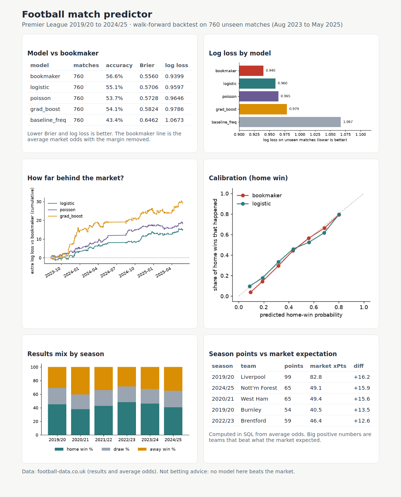

# Football match predictor

[](https://github.com/andriarezki/football-predictor/actions/workflows/ci.yml)

Predict Premier League results (home win / draw / away win) with SQL, Python and machine learning, then check honestly how good the predictions are by comparing them with **bookmaker odds**, the hardest benchmark in football analytics.



## Result in one paragraph

On **760 matches the models never saw** (Aug 2023 to May 2025, retrained every month on the past only), a logistic regression reaches a log loss of **0.960** against **0.940** for the bookmaker's margin-free odds, and **1.067** for always predicting the usual home/draw/away split. So the models learn a lot (they are far better than the baseline), but **none of them beats the market**. That is the expected result and the point of the project: a fair benchmark and a leak-free backtest matter more than a flattering number.

| model | accuracy | Brier | log loss |
|---|---|---|---|
| bookmaker (average odds, margin removed) | 56.6% | 0.5560 | 0.9399 |
| logistic regression (Elo + form + rest days) | 55.1% | 0.5706 | 0.9597 |
| Poisson attack/defence model (time-decayed) | 53.7% | 0.5728 | 0.9646 |
| gradient boosting (same features) | 54.1% | 0.5824 | 0.9786 |
| baseline (class frequencies) | 43.4% | 0.6462 | 1.0673 |

Re-run `python run.py` to reproduce; the numbers are written to `docs/results.csv`.

## What is inside

| Part | File | What it does |
|---|---|---|
| Data | `src/data.py` | Downloads six seasons from football-data.co.uk (polite, cached, not committed), parses them into one table and loads SQLite |
| SQL | `sql/analysis.sql` | Home advantage by season, league tables with `RANK() OVER`, rolling last-5 form with a window frame, points vs market expectation (CTEs, UNION ALL, joins) |
| Features | `src/features.py` | Elo rating, form, goals for/against, rest days, built in one pass so each match only sees earlier matches |
| Poisson model | `src/poisson.py` | Attack/defence strengths and home advantage with exponential time decay (a simplified Dixon-Coles idea) |
| Backtest | `src/evaluate.py` | Walk-forward: for every month retrain on the past, predict that month. Brier score, log loss, accuracy |
| Dashboard | `src/dashboard.py` | Self-contained HTML with charts (`docs/dashboard.html`) |
| Tests | `tests/` | 7 pytest tests: parsing, no-leakage check, probabilities sum to 1, metrics, backtest, SQL |

## How to run

```bash
pip install -r requirements.txt
python run.py              # downloads data, runs SQL + backtest, writes docs/results.csv
python build_dashboard.py  # writes docs/dashboard.html
pytest -q
```

## Honest notes

- **Leakage.** Features and training data only use matches before the one being predicted. A test changes a match's score and checks its own features do not move.
- **Tuning.** The Poisson half-life (180 days) and regularisation (0.01) were chosen on the 2022/23 season only. The 2023/24 and 2024/25 test period was not used for tuning.
- **Why the market wins.** Odds already contain team news, injuries and sharp money. This project uses results only.
- **Not betting advice.** Nothing here shows an edge over the market.
- **One league.** Only the Premier League; results may differ elsewhere.

## Ideas to extend

Expected goals data, player availability, ordinal models for W/D/L, calibration tuning, other leagues.

## Data and licence

Results and average odds come from [football-data.co.uk](https://www.football-data.co.uk/) (credit given; raw files are downloaded at run time, not redistributed here). Code is MIT licensed.
